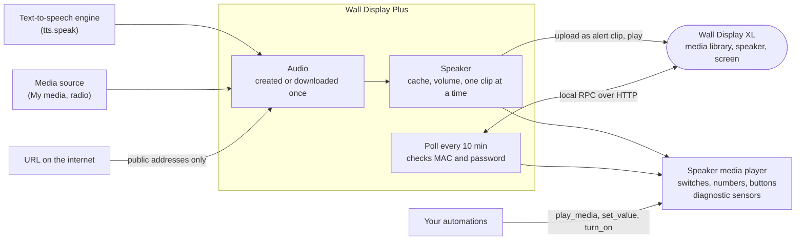
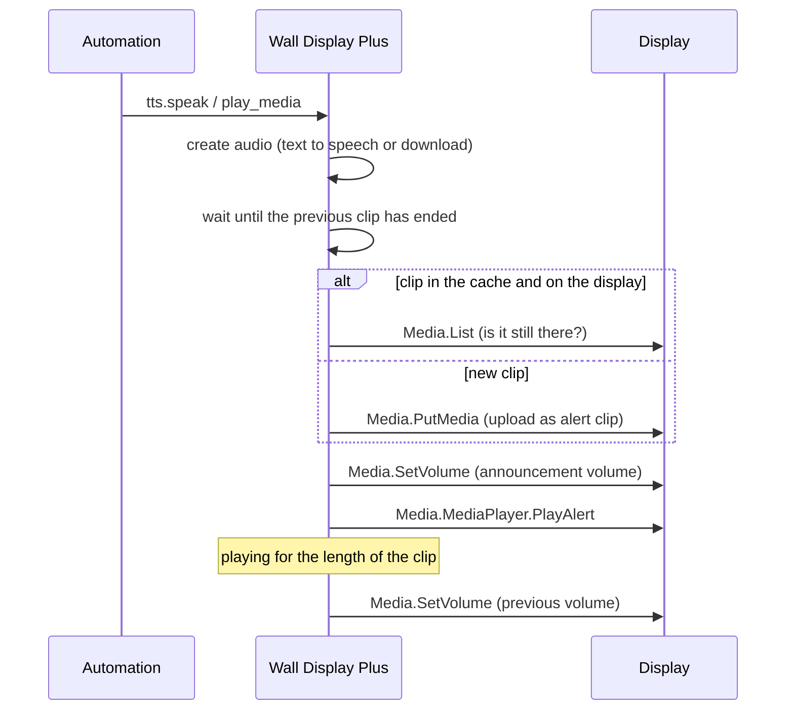
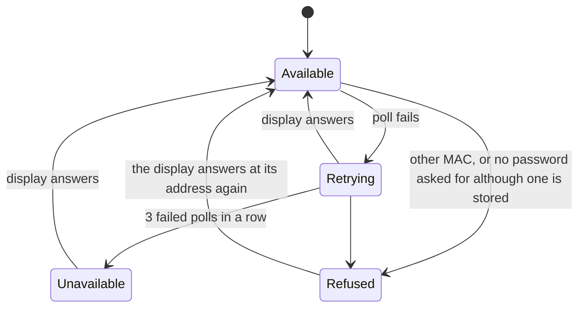

# Wall Display Plus

[](#installation)

A Home Assistant integration that turns the built-in speaker of a Shelly Wall Display XL into a media player: `tts.speak`, announcements and audio files play on the display. It also adds the display's screen settings (motion wakes the screen, dimming, screen off, screen saver), a button that restarts the display app and diagnostic sensors. It complements the official integration for the display, it does not replace it: that integration's media player only plays files already in the display's media library, so `tts.speak` and audio URLs fail there with "Unsupported media ID". This project is not affiliated with or endorsed by Shelly.

What it is for, for example:

- household announcements where people are: washing machine, dishwasher or dryer done, window open while it rains;
- a doorbell or alarm sound on the display in the living room, louder than the music;
- quiet nights: announcements quieter or off, alarms still loud, and motion no longer wakes the screen;
- the same announcement on several displays at once (experimental).

## Design

### Overview



Home Assistant creates the audio: text to speech straight from the engine, media sources and URLs by download. The speaker uploads it to the display's media library as an **alert** clip, plays it once and keeps it for the next time. Alert clips stay out of the music playlist and out of the media browser of the official integration. The screen settings and the sensors come from the display's local RPC interface.

### An announcement



Announcements play one after another; a second one waits until the first has ended. The display goes back to its previous volume after each clip, so music keeps its own volume. At an announcement volume of 0 % an announcement is skipped altogether: no text to speech, no upload, and the next one does not wait.

### Cache

Every clip is named `homeassistant_<tag>_<key>.<ext>`. The tag is random per config entry, so several Home Assistant instances can share one display without touching each other's clips; files of others (music, photos, ringtones) are never touched. The key is derived from what was played with a random secret per display that only Home Assistant knows: text to speech by its text, engine, language and options (such as the voice), downloaded audio by its content, so a file that changes behind the same URL is uploaded anew.

- A clip stays on the display within a size limit (500 MB by default) and is deleted when it was not played for 90 days (both options). When a new clip does not fit, the clips played longest ago go first.
- At least 100 MB of the display's storage stay free. If deleting its own clips is not enough, the clip is not uploaded and a repair issue appears.
- If a cached clip is gone from the display, it is uploaded again.
- `extra: {cache: false}` plays a clip without keeping it; it is deleted right after it was played.

### Several displays (experimental)

> **Experimental.** Playing on several displays at the same time was tested with simulated displays only. How close together the displays start depends on the network and the displays. Please report what you observe in an [issue](https://github.com/n-schilling/ha-wall-display-plus/issues).

One announcement for several displays plays on all of them at the same time:

1. Home Assistant creates the audio **once** (the text-to-speech engine runs once, a URL is downloaded once).
2. Each display gets ready: it waits until its previous announcement has ended, uploads the clip if it does not have it yet, and sets the announcement's volume.
3. When all displays are ready, all start together.
4. The first ready display waits **at most 10 seconds** for the others. A display that is not ready by then does not play, and the action reports it as an error. The others have played.

This works in two ways, without anything else to set up:

- **Dynamic:** all speakers in one action call, for example `tts.speak` with several `media_player_entity_id`, or `media_player.play_media` with several entities. A media player group helper of Home Assistant works the same way.
- **Speaker group:** a fixed group as its own media player, for automations that always announce in the same rooms. Add it with **Add integration → Wall Display Plus → Speaker group (experimental)** (offered once at least two displays are set up); change its members with **Configure**. The group's state is *playing* while any member plays; members that are unavailable are left out. Unlike a media player group helper, it waits until all members have started and reports failed members as an error.

A speaker that is targeted twice in one action (directly and through a group) plays once.

### Data updates and availability

The integration polls the display **every 10 minutes**, on purpose: the display is a small device. Everything the integration does itself shows at once: switches, numbers and buttons show their new value immediately, the playing state and the announcement delay change with each clip, and the cache sensors follow an upload or deletion within a few seconds. When an announcement fails because the display does not answer, it is polled right away.

What can be up to 10 minutes old: changes made on the display itself, memory, storage, CPU temperature and a crash of the display app. `homeassistant.update_entity` on any entity of the display refreshes all of them; a shorter polling interval is not an option.



- **Retrying:** a request that only reads is sent once more after a second; writes (uploads, playing, settings) are never repeated. A failed poll keeps the last values and is repeated every minute. Firmware 2.8.4 sometimes leaves a request unanswered for half a minute; that neither makes the entities unavailable nor keeps switches from working.
- **Unavailable:** after three failed polls in a row (about two minutes), polled every minute.
- **Refused:** every poll first reads the device information at the address. If the MAC is not the display's, or the device no longer asks for the password stored for it, nothing else is read or sent, the entities are unavailable at once and a repair issue explains it. The same check runs at setup and before the clips are deleted on removal.

### Settings

**Settings → Devices & services → Wall Display Plus → Configure**:

| Option | Default | Description |
|---|---|---|
| Keep clips for | 90 days | A cached clip is deleted from the display when it was not played for this many days (1–365). |
| Maximum cache size | 500 MB | The cached clips may take at most this much storage on the display (10–10000 MB). When a new clip does not fit, the clips played longest ago are deleted first. A single clip larger than the limit is played once and not kept. |
| Maximum text length | 500 characters | Longer texts are refused before the text-to-speech engine runs (50–5000). 500 characters are about 35 seconds of speech. |

A speaker group (experimental) has one option, its **Speakers**: the speakers of at least two displays.

### Text-to-speech engine

The integration plays what a text-to-speech engine produces; it does not speak itself. Any engine in Home Assistant works, for example **Piper** (local, as a Home Assistant app with the Wyoming integration), Home Assistant Cloud or Google Translate.

**The voice is chosen in the engine, not here.** With Piper, the default voice is set in the Piper app's configuration. A single announcement can use another voice through the options of `tts.speak`:

```yaml
action: tts.speak
target:
  entity_id: tts.piper
data:
  media_player_entity_id: media_player.living_room_wall_display_speaker
  message: The washing machine is done.
  options:
    voice: en_US-lessac-medium
```

Options such as the voice are part of the cache key, so another voice is another clip. A changed *default* voice is not visible to the integration: press **Clear speaker cache** afterwards.

**How fast an announcement starts depends on the engine, the voice and the hardware.** A local engine runs on the Home Assistant host. As a rough guide: Piper with a German "medium" voice on a Raspberry Pi 5 created 6.5 seconds of speech in about 1 second. "high" voices sound better and take noticeably longer; "low" voices are faster. The upload to the display adds well under a second. A cached announcement skips both: it starts at once.

To keep the host from long work by mistake, texts are limited to 500 characters (option *Maximum text length*). The limit applies to announcements through this speaker; answers of the voice assistant arrive as a stream without the text and are not limited.

### Supported devices

| Device | Status |
|---|---|
| Wall Display XL (SAWD-3A1XE10EU2), firmware 2.8.2 and 2.8.4 | Supported and tested |
| Other wall displays (for example SAWD-0A1XX10EU1) | Not offered and refused during setup |

Only the Wall Display XL is offered: it has the speaker and the motion sensor this integration is about. The firmware of other wall displays offers the same media interface but does not report whether a speaker is built in, so the integration recognizes the XL by its model. If you have another model with a speaker that should be supported, please open an [issue](https://github.com/n-schilling/ha-wall-display-plus/issues) with its model name.

### What may be played from where

- **Text to speech and media sources** are open to every user who may control the speaker, as with other media players. A media source item of this Home Assistant instance (for example **Media → My media**) is fetched from Home Assistant itself.
- **A URL** is downloaded by Home Assistant itself, not by the display. So only administrators may play one; automations and scripts may as well. A user without administrator rights gets "Unauthorized".
- **Only public addresses:** a URL, and a media source item that points elsewhere (a radio station, for example), is fetched only if every address of its host is public. Addresses of your network, of the Home Assistant host and of its app network, link-local and reserved addresses are refused before any request goes out, also after a redirect (at most three, each checked) and when a name resolves to such an address. Play files from your own network through a media source instead.
- Paths of your Home Assistant instance such as `/api/...` are never signed: anyone allowed to play a URL could otherwise copy protected data into the display's media library.
- An error message about a download names neither the address nor the answer of the server.

### Privacy and security

- **Clips stay on the display** until they were not played for the configured time or the cache needs room. They are audio files in the display's media library.
- **Set a password on the display, and give it a fixed address** (DHCP reservation in your router). Without a password, any device on your network can list the media library. The MAC that discovery and every poll check can be read without a login, so a device that pretends to be the display could take over its address; with a password, the integration also notices when a device at the address no longer asks for it. The file names show that a clip comes from Home Assistant, but not which text it holds.
- **The password** is sent with HTTP digest authentication, the only login the display offers. A device that intercepts it could try to guess the password offline, so choose a long one.
- **For sensitive texts use `extra: {cache: false}`:** the clip is deleted right after it was played.
- **The connection to the display is plain HTTP** (the display offers nothing else). Announcements travel unencrypted through your local network.
- **Diagnostics hold nothing personal:** no password, address or MAC, no cache keys, file names or play times, nothing about what the display played. Error messages leave out user, password and query part of URLs.
- **Clear speaker cache** also creates a new secret.
- The integration sends no telemetry and contacts no third party; it only downloads URLs you ask it to play.

## Examples

Text to speech:

```yaml
action: tts.speak
target:
  entity_id: tts.piper
data:
  media_player_entity_id: media_player.living_room_wall_display_speaker
  message: The washing machine is done.
```

A text that changes every time (times, counts) should not be cached:

```yaml
action: media_player.play_media
target:
  entity_id: media_player.living_room_wall_display_speaker
data:
  media_content_type: music
  media_content_id: media-source://tts/tts.piper?message=Dinner+in+15+minutes
  extra:
    cache: false
```

Louder at night for the alarm, at its own volume:

```yaml
action: media_player.play_media
target:
  entity_id: media_player.living_room_wall_display_speaker
data:
  media_content_type: music
  media_content_id: media-source://tts/tts.piper?message=Alarm+in+the+garage
  announce: true
  extra:
    volume: 1.0
```

An audio file:

```yaml
action: media_player.play_media
target:
  entity_id: media_player.living_room_wall_display_speaker
data:
  media_content_type: music
  media_content_id: https://example.com/doorbell.mp3
```

The same announcement on two displays at once (experimental):

```yaml
action: tts.speak
target:
  entity_id: tts.piper
data:
  media_player_entity_id:
    - media_player.living_room_wall_display_speaker
    - media_player.kitchen_wall_display_speaker
  message: Dinner is ready.
```

### Night mode

There is no separate night mode: an automation sets the announcement volume and the motion switch. From 22:00 announcements are quieter (`0` skips them altogether) and motion does not wake the screen; at 7:00 both go back. Announcements with their own volume, such as the alarm above, are not affected.

```yaml
triggers:
  - trigger: time
    at: "22:00:00"
    id: night
  - trigger: time
    at: "07:00:00"
    id: day
actions:
  - choose:
      - conditions:
          - condition: trigger
            id: night
        sequence:
          - action: number.set_value
            target:
              entity_id: number.living_room_wall_display_announcement_volume
            data:
              value: 20
          - action: switch.turn_off
            target:
              entity_id: switch.living_room_wall_display_motion_wakes_screen
      - conditions:
          - condition: trigger
            id: day
        sequence:
          - action: number.set_value
            target:
              entity_id: number.living_room_wall_display_announcement_volume
            data:
              value: 70
          - action: switch.turn_on
            target:
              entity_id: switch.living_room_wall_display_motion_wakes_screen
```

With several displays, a display at 0 % is left out and the others play.

## Known limitations

- **Several displays (experimental)** start within the time the display needs to answer one request, not sample-accurate; on a busy network or a slow display you may hear an echo. Two announcements to several displays that share a display play one after another; announcements to different displays play at the same time.
- **Playing state:** the speaker is *playing* while its own clip plays. Firmware 2.8.2 keeps reporting an alert clip as playing long after it ended, so that report is not used; an alert started on the display itself is not shown.
- **Volume:** the display has a single volume for music and announcements. The speaker sets it to the announcement volume (or the announcement's own) for each clip and goes back afterwards. If setting it fails, the clip plays at the current volume; if going back fails, it is tried again after five seconds and before the next clip. Music that plays while an announcement plays is heard at the announcement's volume for that time.
- **A changed default TTS voice is not part of the cache.** A voice set in the announcement's options is; after changing the engine's or the assistant's default voice, press **Clear speaker cache**, otherwise cached announcements keep the old voice until they expire.
- **What can be played:** text to speech, media sources and absolute `http(s)` URLs that return audio, up to 20 MB. A URL is played only from a public address and only when an administrator, an automation or a script asks for it; see [What may be played from where](#what-may-be-played-from-where). Files on your own network play through a media source.
- **Motion and screen settings are written only when the value changes.** Every write makes the official integration reload, and its entities are unavailable for a moment. Do not change these settings from an automation that triggers on those entities becoming available again: that is a loop.
- **Storage:** before every upload the integration checks the display's free storage. At least 100 MB must stay free; if not, it first deletes its own clips (never photos, videos, music or ringtones). If that is not enough, the clip is not uploaded and a repair issue "storage almost full" appears.
- **File names** are at most 50 ASCII bytes. Firmware 2.8.2 stores names up to 250 bytes and silently drops longer ones.
- **Undocumented interface:** the media upload uses the calls of the display's own web interface, which are not in the published API documentation. A firmware update can change them; the integration then shows a repair issue.
- **Stop** only stops a clip of this integration. While none plays, `media_player.media_stop` does nothing, so the display's own music keeps playing.
- Discovery works over IPv4 only. It never moves a display with a password to a new address: anyone on the network can announce a display's name, and the login would go to that device. Use **Reconfigure** after an address change.

## Troubleshooting

| Problem | What to do |
|---|---|
| Nothing to hear | Press **Test announcement volume**. If it is too quiet, raise **Announcement volume** (at 0 % nothing plays; check a night-mode automation); also check that no Bluetooth speaker is connected to the display instead. |
| "This device is not a Wall Display XL" | Only the Wall Display XL (SAWD-3A1XE10EU2) is supported; see [Supported devices](#supported-devices). |
| "Reconfigure" on a speaker group | A group has no connection settings; change its speakers with **Configure**. |
| Repair issue "the firmware does not support the speaker" | The firmware changed the interface. [Open an issue](https://github.com/n-schilling/ha-wall-display-plus/issues/new/choose) with model and firmware. The issue disappears once a clip plays again. |
| Entities unavailable | The display is off or has a new address. Without a password, discovery picks up the new address; with a password, use **Reconfigure**. |
| Repair issue "a different device answers at its address" | The display got a new address and another device the old one. Nothing is sent to that device. Give the display a fixed address in your router (DHCP reservation) and use **Reconfigure**. |
| Repair issue "the display no longer asks for its password" | A password is stored, but the device at the address accepts requests without one. Nothing is sent to it. If you turned the password off yourself, remove it with **Reconfigure**; otherwise check which device has the address. |
| Repair issue "storage almost full" | Delete photos, videos or music in the display's web interface. The issue disappears once a clip plays again. |
| "Unsupported media" or "not audio" | Only text to speech, media sources and http(s) URLs with audio can be played. |
| "only played from public addresses" | The URL points into your network (or redirects there). Play the file through a media source instead, for example from **Media → My media**. |
| "Unauthorized" when playing a URL | Only administrators may play URLs (automations and scripts may as well). Text to speech and media sources are open to every user. |
| Old voice after changing it | Press **Clear speaker cache**. |
| Something else | Download the diagnostics from the integration's page and attach them to an [issue](https://github.com/n-schilling/ha-wall-display-plus/issues/new/choose). They hold no password, address or announcement texts. Security problems: see [SECURITY.md](SECURITY.md). |

## Interface

### Entities

In Home Assistant a device belongs to a single integration, so the entities get their own device next to the one of the official integration. Both carry the display's MAC address. The unique IDs are `<mac>_<key>`; the speaker group's is its config entry ID.

| Entity | What it does |
|---|---|
| Speaker (`media_player`) | Plays text to speech, media sources and audio URLs as announcements. Supports `tts.speak`, `media_player.play_media` (with `announce`), stop and media browsing (audio only). |
| Speaker group (`media_player`, experimental) | Plays on all its member speakers at the same time; see [Several displays](#several-displays-experimental). Attribute `entity_id` lists the members. |
| Motion wakes screen (`switch`, configuration) | Whether motion in front of the display wakes the screen. Touch always does. |
| Dim screen when idle, Turn screen off when idle, Screen saver (`switch`, configuration) | The display's own screen settings. |
| Announcement volume (`number`, configuration) | Volume of announcements that bring no volume of their own, 70 % by default, in steps of 10 %. Applies to `tts.speak` as well. The display goes back to its previous volume after each announcement, so music keeps its own volume. Can be changed from automations, for example quieter at night; see [Night mode](#night-mode). At 0 % such announcements are skipped: no text to speech, no upload, and the next announcement does not wait. |
| Minimum brightness, Dim after, Screen off after, Screen saver after (`number`, configuration) | Minimum brightness in %, timeouts 10–3600 s. |
| Test announcement volume (`button`, configuration) | Speaks a short test sentence ("This is a test of the announcement volume.", in German for a German Home Assistant) at the announcement volume. It uses the text-to-speech of the preferred voice assistant, otherwise Home Assistant's default engine. |
| Clear speaker cache (`button`, configuration) | Deletes every clip this integration put on the display and creates a new secret for the file names. |
| Restart display app (`button`, configuration) | Restarts only the display app, faster than restarting the device; helps when the dashboard hangs. |
| Free memory, Free storage, Cached clips, Cache size, Announcement delay, App started (`sensor`, diagnostic) | How the display and the speaker are doing. *Cached clips* has the attribute *File prefix* (`homeassistant_<tag>_`): every file of this integration in the display's media library starts with it. Which text a clip holds is not shown anywhere, on purpose. *App started* moves without a device restart when the display app crashed or was restarted. *Announcement delay* is the time from the request to the start of the last announcement. |
| CPU temperature, Cache hit rate (`sensor`, diagnostic, disabled by default) | Temperature of the display's processor; share of announcements played without creating and uploading them again (since Home Assistant started). |

Manual brightness and automatic brightness are left out on purpose: while automatic brightness is on, the display reports its current brightness (0 while the screen is off) as the manual level, so turning the automatic off could leave the screen black.

### Playing

`media_player.play_media` and `tts.speak` on the speaker or a speaker group accept:

| `media_content_id` | Played |
|---|---|
| `media-source://tts/...` | Text to speech; cached by text, engine, language and options. |
| `media-source://...` | A media source item with audio; cached by content. |
| `http://...`, `https://...` | Audio from a public address, up to 20 MB; administrators, automations and scripts only; cached by content. |

| `extra` | Effect |
|---|---|
| `cache: false` | Play without keeping the clip. |
| `volume: 0.8` | Play this clip at its own volume (0–1, like `volume_set`) instead of the announcement volume; the display goes back afterwards. At `0` it is skipped. |

`media_player.media_stop` stops a clip of this integration; while none plays, it does nothing.

## Installation

1. **Settings → Marketplace → Add from link** (top right), enter `https://github.com/n-schilling/ha-wall-display-plus` as GitHub link and add it. Adding a repository by link asks you to connect GitHub once.
2. Install **Wall Display Plus** in the Marketplace and restart Home Assistant.
3. Displays on the network are discovered and shown under **Settings → Devices & services**; confirm one. Or add one by hand: **Add integration → Wall Display Plus**.

| Parameter | Description |
|---|---|
| Host | IP address or host name of the display. Discovered displays fill it in themselves. A new address is picked up automatically only for displays without a password, and only if the device at the new address reports the same MAC; with a password, use **Reconfigure**. |
| Password | Only if a password is set on the display (user `admin`, digest authentication). Leave empty otherwise. |

The address and the password can be changed later with **Reconfigure**. If the display rejects the password, Home Assistant asks for the new one. Adding a display that is set up already by hand takes over the new address and password.

Requires Home Assistant 2026.11 or later, and a text-to-speech engine for announcements (see [Text-to-speech engine](#text-to-speech-engine)). Without the Marketplace, copy `custom_components/wall_display_plus` into the `custom_components` folder of your configuration directory and restart. There are no requirements outside Home Assistant.

### Removal

1. **Settings → Devices & services → Wall Display Plus → ⋮ → Delete**. The integration deletes its clips from the display on the way, if the display at the address is the one set up.
2. Remove the integration in the Marketplace and restart Home Assistant.

If the display was not reachable during the removal, its clips stay there. Delete the files starting with the *File prefix* of the *Cached clips* sensor (`homeassistant_<tag>_`) in the display's web interface.

Speaker groups are entries of their own: delete them the same way. A group whose display was deleted keeps the missing speaker as a member until you change the group's speakers with **Configure**. The display's screen settings stay as they were last set.

## Development

```bash
uv venv --python 3.14 && uv pip install -r requirements_test.txt
scripts/check.sh
```

`scripts/check.sh` runs what CI runs: ruff, the changelog and translation checks, mypy, the tests with their coverage threshold and hassfest in Docker. The CI job HACS, which validates the repository for the Marketplace, runs on GitHub only.

The tests run against a display simulated in memory (`tests/conftest.py`) and, for the RPC client, against a local HTTP twin with digest authentication (`tests/test_api.py`). The rules of the Home Assistant integration quality scale are tracked in [`quality_scale.yaml`](custom_components/wall_display_plus/quality_scale.yaml).

Releases: CI on `main` tags the version from `manifest.json` and publishes a GitHub release with its CHANGELOG section; the Marketplace offers it as an update.

## License

Apache License 2.0, see [LICENSE](LICENSE).
